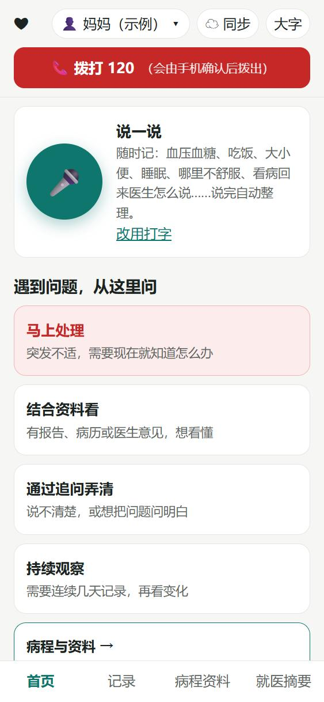
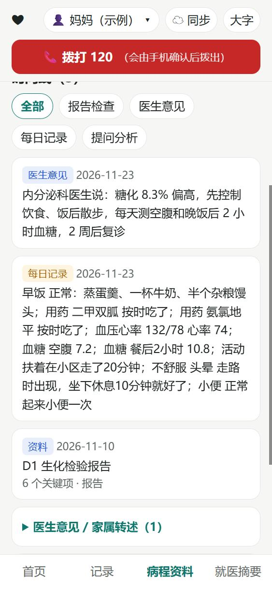
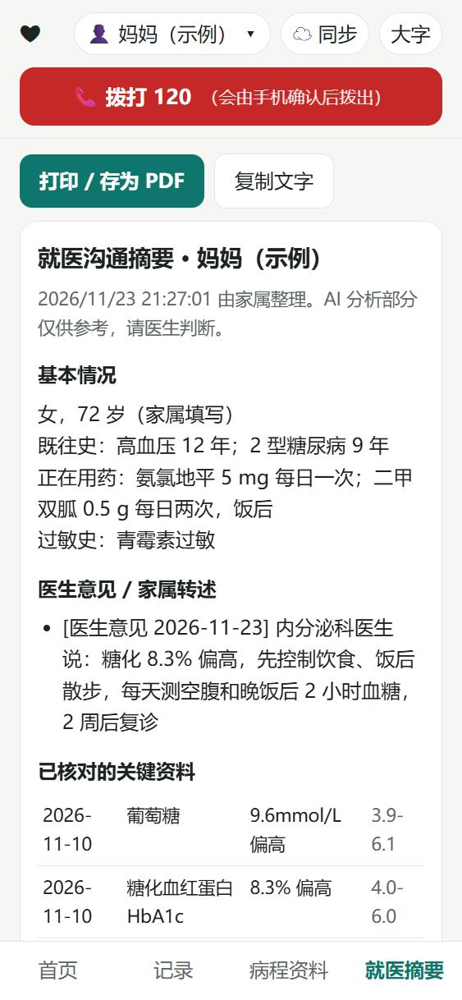

# 家人健康簿 · Family Health Record

**A free, privacy-first personal health record (PHR) for family caregivers.** Log blood pressure, blood glucose, meals, medications and symptoms by voice; snap photos of lab reports and medical records; get an auto-built illness timeline and a one-page summary to bring to the doctor. Data stays in your browser; optional multi-device sync is end-to-end encrypted. Includes `tools/medical-brief`, a script that turns a JSON file into a doctor-visit brief, illness timeline (PDF/Excel) and CGM (continuous glucose monitoring) summary. Chinese UI. Not a medical device.

给照顾老人或病人的家属用的健康记录网页：说一句话就能记下每天的血压、血糖、饮食、用药和不舒服；拍照整理化验单和病历；自动排成病程时间线；看医生前一键生成就医摘要。

线上版：<https://health.xiaowen.ai/>，免费、免登录。

> 只做记录和整理，不是医疗器械，不做诊断。胸痛、说话不清、一侧手脚无力、意识不清等紧急情况，请直接拨打 120。

## 截图

<table>
<tr>
<td align="center"><br>首页：按住说话就能记</td>
<td align="center"><br>一段话自动拆成多条记录</td>
<td align="center"><br>病程时间线</td>
<td align="center"><br>一键生成就医摘要</td>
</tr>
</table>

截图中的「妈妈（示例）」是虚构病人，资料都是编的。

## 特点

- **资料默认只存在用户自己的浏览器里**，服务器不落库。
- **多设备同步可选**：同步码在本机派生密钥，AES-GCM 加密后再上传，服务器只存密文（见 `schema.sql`）。
- **多模型交叉看**：同一份资料让几个模型分别整理，再合成一份，减少单个模型的偏差。
- **语音记录**：按住说话，Whisper 转文字后自动拆成每日记录。

## 目录

```
public/index.html    单页前端
src/worker.js        Cloudflare Worker：静态页 + 模型代理 + 加密同步 + 限流
schema.sql           D1 表结构（只存密文）
tools/medical-brief  病历整理工具：JSON → 就诊沟通单 / 病程时间线 / 动态血糖汇总 PDF
```

## 自己部署

需要 Cloudflare 账号和 Node.js。

```bash
npm i -g wrangler
wrangler d1 create family-health-sync          # 把返回的 database_id 填进 wrangler.toml
wrangler d1 execute family-health-sync --remote --file=schema.sql
cp .dev.vars.example .dev.vars                 # 本地开发用，填你自己的 key
wrangler secret put HK_KEY                      # 线上密钥
wrangler secret put DS_KEY
wrangler deploy
```

部署前请改掉 `wrangler.toml` 里的 `routes`（自定义域名）和 `database_id`。模型和接口地址在 `src/worker.js` 顶部的 `SLOTS` 里，可以换成你自己的服务商。

**调用模型会产生费用**，部署后请自己设置限额。Worker 里已经按 IP 做了每分钟 40 次的限流。

## 许可证

MIT
